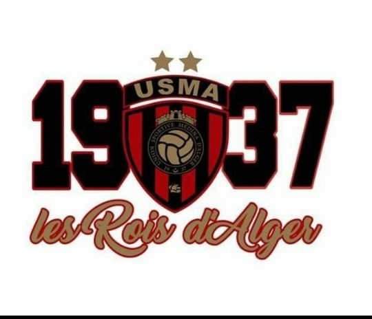

[index.html](https://github.com/user-attachments/files/33282691/index.html)
<!DOCTYPE html>
<html lang="ar" dir="rtl">
<head>
    <meta charset="UTF-8">
    <meta name="viewport" content="width=device-width, initial-scale=1.0">
    <title>اتحاد العاصمة - USMA 1937</title>
    
</head>
<body>

    <header>
        
USMA 1937

        <nav>
            <a href="#" onclick="showPage('home')" id="nav-home" class="active">الرئيسية</a>
            <a href="#" onclick="showPage('titles')" id="nav-titles">ألقاب النادي</a>
            <a href="#" onclick="showPage('matches')" id="nav-matches">جدول المباريات</a>
            <a href="https://instagram.com/jalil_jalil10.1" target="_blank">تواصل معنا</a>
        </nav>
    </header>

    <!-- الصفحة الرئيسية -->
    <main id="home" class="page-section active">
        

            
            
            <h1>مرحباً بكم في موقع اتحاد العاصمة</h1>
            
Les Rois d'Alger - ملوك العاصمة منذ 1937

            

                <button class="btn btn-primary" onclick="showPage('titles')">استكشف النادي</button>
                <button class="btn btn-primary" onclick="showPage('matches')">جدول المباريات</button>
                <a href="https://instagram.com/jalil_jalil10.1" target="_blank" class="btn btn-secondary">تواصل معي</a>
            

        

    </main>

    <!-- واجهة ألقاب النادي -->
    <main id="titles" class="page-section">
        

            <h2>خزانة ألقاب اتحاد العاصمة</h2>
            
سجل حافل بالبطولات والإنجازات التاريخية لملوك العاصمة

        

        

            

                <h3>كأس الجزائر 10 ألقاب</h3>
                
أعوام: 1981، 1988، 1997، 1999، 2001، 2003، 2004، 2013، 2025، 2026.

            

            

                <h3>الرابطة المحترفة الأولى 8 ألقاب</h3>
                
أعوام: 1963، 1996، 2002، 2003، 2005، 2014، 2016، 2019.

            

            

                <h3>كأس الكونفيدرالية الإفريقية 2 ألقاب</h3>
                
مواسم: 2022–23 و 2025–26.

            

            

                <h3>كأس السوبر الإفريقي لقب واحد</h3>
                
عام 2023 (أمام الأهلي المصري).

            

            

                <h3>كأس السوبر الجزائري 2 ألقاب</h3>
                
أعوام: 2013، 2016.

            

            

                <h3>كأس العرب للأندية الأبطال لقب واحد</h3>
                
عام 2013.

            

        

        <button class="btn btn-secondary" onclick="showPage('home')" style="margin-top: 20px;">العودة للرئيسية</button>
    </main>

    <!-- واجهة جدول المباريات القادمة -->
    <main id="matches" class="page-section">
        

            <h2>جدول المباريات القادمة</h2>
            
مواعيد مواجهات سوسارة ورجال اتحاد العاصمة القادمة

        

        

            

                <h3>المباراة القادمة الرابطة الأولى</h3>
                

                    اتحاد العاصمة 🔴⚫
                    VS
                    شبيبة الساورة 🟡
                

                
📅 **التاريخ:** الثلاثاء 13 أكتوبر 2026

                
⏰ **التوقيت:** 20:00 (بتوقيت الجزائر)

                
Stadium **الملعب:** ملعب عمر حمادي (بولوغين)

            

            

                <h3>كأس الكونفيدرالية الدور التمهيدي</h3>
                

                    بانثرز FC ⚽
                    VS
                    اتحاد العاصمة 🔴⚫
                

                
📅 **التاريخ:** الأحد 18 أكتوبر 2026

                
⏰ **التوقيت:** 16:00 (بتوقيت الجزائر)

                
Stadium **المسابقة:** ذهاب الدور الثاني - CAF

            

            

                <h3>الرابطة المحترفة الجولة 9</h3>
                

                    اتحاد العاصمة 🔴⚫
                    VS
                    مولودية وهران 🔴⚪
                

                
📅 **التاريخ:** الخميس 22 أكتوبر 2026

                
⏰ **التوقيت:** 15:00 (بتوقيت الجزائر)

                
Stadium **الملعب:** ملعب عمر حمادي

            

            

                <h3>إياد CAF الكونفيدرالية</h3>
                

                    اتحاد العاصمة 🔴⚫
                    VS
                    بانثرز FC ⚽
                

                
📅 **التاريخ:** الأحد 25 أكتوبر 2026

                
⏰ **التوقيت:** 20:00 (بتوقيت الجزائر)

                
Stadium **المقابلة:** إياب الدور التمهيدي القاري

            

        

        <button class="btn btn-secondary" onclick="showPage('home')" style="margin-top: 20px;">العودة للرئيسية</button>
    </main>

    <footer>
        تصميم ومطوَّر بواسطة <strong>جليل</strong> | جميع الحقوق محفوظة © 2026
    </footer>

    

</body>
</html>
